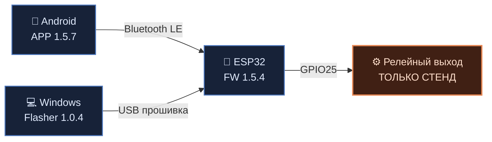

<div align="center">

# ⚡ IERIKHON
### ИЕРИХОН · Android × ESP32 × Bluetooth LE

**Открытая для изучения кодовая база экспериментального проекта управления релейным выходом**

<p>
  
  
  
</p>

<p>
  
  
  
</p>

<p>
  <a href="https://t.me/SDRX_GARAGE"></a>
</p>

**[💬 Telegram-канал SDRX_GARAGE](https://t.me/SDRX_GARAGE)** · новости и идеи проекта

[**📖 Для новичка**](docs/START-HERE.md) ·
[**💻 Весь исходный код**](docs/SOURCE-MAP.md) ·
[**🛠️ Настройка под себя**](docs/CUSTOMIZATION.md) ·
[**🤖 Контекст для ИИ**](docs/AI-QUICK-CONTEXT.md) ·
[**🔌 Схема и проверка**](docs/WIRING-SCHEME.md)

</div>

---

> [!CAUTION]
> **Экспериментальный проект — не готовая безопасная система автозапуска мотоцикла.**
> Сохранённая прошивка ESP32 v1.5.4 не проверяет авторизацию BLE-клиента, нейтраль и сцепление. Не подключайте её к действующему стартеру без отдельной аппаратной защиты и испытаний. [Подробный разбор рисков](docs/SECURITY-NOTICE-v1.5.4.md).

## 🧩 Что такое IERIKHON?

IERIKHON состоит из трёх компонентов: Android-приложения, платы ESP32 и прошивальщика для Windows. Через Bluetooth приложение передаёт команды ESP32, а прошивальщик записывает программу в плату по USB.



| Компонент | Версия | Технология | Код |
|---|:---:|---|---|
| 📱 Android | **1.5.7** | Java / Android SDK / BLE | [Готовый Java после всех патчей](source-archive/v1.5.7/generated/android/MainActivityV152.java) |
| 🔌 ESP32 | **1.5.4** | Arduino C++ / ESP32 BLE | [Прошивка `.ino`](firmware/IERIKHON_v1.5.4/IERIKHON_v1.5.4.ino) |
| 💻 Windows Flasher | **1.0.4** | Python / Tkinter / PyInstaller | [Исходники Python](pc-flasher/) |

## 🗺 Как устроен проект — схема и материалы

[**🔌 Блочная схема питания и реле, с разбором ошибок исходной иллюстрации**](docs/WIRING-SCHEME.md). Рисунок пользователя пока не загружен в GitHub; документ описывает его состав и критичные ограничения. Не используйте изображение как проверенную монтажную инструкцию.

[**🤖 Документ для нейросетей**](docs/AI-QUICK-CONTEXT.md) — что за система, версии, ключевые файлы, правила изменения и готовое задание для ChatGPT/Qwen.

## 🚀 С чего начать?

| Ваша задача | Открыть |
|---|---|
| **Впервые вижу IERIKHON** — что это и как устроено? | [Простое объяснение](docs/START-HERE.md) |
| **Хочу посмотреть весь код**, без декомпиляции | [Карта всех исходников](docs/SOURCE-MAP.md) |
| **Нужна именно Java-версия 1.5.7** | [Готовый объединённый исходник](source-archive/v1.5.7/generated/android/MainActivityV152.java) |
| **Хочу собрать свой APK** | [Сборка Android](docs/ANDROID-BUILD.md) |
| **Хочу собрать Windows EXE** | [Сборка прошивальщика](docs/FLASHER-BUILD.md) |
| **Хочу прошить ESP32 с Android через USB-OTG** | [Мобильный прошивальщик v1.0.1](mobile-flasher/README.md) · [результаты аудита](docs/MOBILE-FLASHER-AUDIT.md) |
| **Хочу поменять внешний вид или имя устройства** | [Персонализация](docs/CUSTOMIZATION.md) |
| **Хочу загрузить код в ChatGPT, Qwen или другой ИИ** | [Быстрый контекст для ИИ](docs/AI-QUICK-CONTEXT.md) · [Подробная инструкция](docs/AI-HANDOFF.md) |
| **Хочу понять схему подключения и её ограничения** | [Описание схемы и проверка безопасности](docs/WIRING-SCHEME.md) |
| **Хочу перейти в Telegram SDRX_GARAGE** | [Открыть канал](https://t.me/SDRX_GARAGE) |
| **Хочу проверить оригинальность версий** | [Происхождение и SHA-256](docs/PROVENANCE.md) |
| **Хочу предложить улучшение** | [Участие в разработке](docs/CONTRIBUTING.md) |

<details>
<summary><strong>📂 Посмотреть структуру проекта</strong></summary>

```text
IERIKHON/
├── app/                        # Android Java + Gradle + Manifest
├── firmware/                   # Исходники прошивок ESP32
│   └── IERIKHON_v1.5.4/       # Парная версия для Android 1.5.7
├── pc-flasher/                 # Python-код прошивальщика 1.0.4
├── tools/                      # Последовательные Android-патчи
│   ├── v154_patch.py
│   ├── soft_ui_patch.py
│   └── v157_patch.py
├── source-archive/v1.5.7/     # Архив оригинальных исходников (Gradle подпись очищена)
│   └── generated/android/     # Готовый Java 1.5.7 после всех патчей
├── scripts/                    # Экспортёр исходников без изменения оригиналов
├── docs/                       # Инструкции, безопасность, проверка
└── .github/workflows/          # CI-проверки и рецепты сборки
```

</details>

## 🔍 Важное о версиях и оригинальности

**Android 1.5.7 — не один исходный файл.** Он получался из базового `MainActivityV152.java` последовательностью патчей `v154 → soft_ui → v157`. В папке [generated](source-archive/v1.5.7/generated/) уже лежит **готовый объединённый Java-код**, собранный и проверенный через GitHub Actions. Исходные файлы при этом сохранены неизменными в [source-archive](source-archive/v1.5.7/README.md).

**Android `main` содержит также более позднюю конфигурацию 1.5.8.** Не путайте её с архивом 1.5.7.

Архивные APK 1.5.7 и EXE Flasher 1.0.4 были проверены и распакованы владельцем проекта при подготовке репозитория. Авторский Java/Python/INO-код найден в исходном GitHub и сохранён, а не выдуман из декомпиляции. **Побайтовое совпадение пересобранных установщиков с оригинальными пока не доказано.** Исторические APK/EXE **не размещены в GitHub Releases** — [полный отчёт о проверке](docs/PROVENANCE.md).

## ✅ Что проверено

- **Исторические авторские исходники** перенесены в отдельный архив. Три Gradle-конфигурации подписи очищены от встроенных тестовых данных, поэтому их Git blob SHA в публичной копии отличается от приватных оригиналов.
- **Android Java v1.5.7** успешно восстановлена запуском оригинальной цепочки патчей в CI.
- Есть отдельный скрипт `scripts/export_v157_snapshot.py`: готовит редактируемую копию, **не меняя исходники**.
- Сохранена версия прошивки ESP32 **1.5.4** и Python-код Flasher **1.0.4**.

## 🔒 Безопасность, права и публикация

Эта версия предназначена для **изучения и испытаний на изолированном стенде**. Для реального транспорта требуются независимые аппаратные блокировки и защита BLE-команд. Смотрите [Security Notice](docs/SECURITY-NOTICE-v1.5.4.md).

Лицензия пока не утверждена владельцем. **Читать исходники ≠ автоматически иметь разрешение изменять и распространять их.** Порядок подготовки публичного релиза описан в [правилах участия](docs/CONTRIBUTING.md). **Публичная копия имеет новую Git-историю с адресами GitHub `noreply`.** Старая история с личным email не переносилась — [проверка приватности](docs/PRIVACY-BEFORE-PUBLIC.md) и [особенности публикации](docs/PUBLICATION-NOTES.md).

---

<div align="center">
  <sub>IERIKHON • SDRX · <a href="https://t.me/SDRX_GARAGE">SDRX_GARAGE on Telegram</a> · исходники и документация</sub>
</div>
