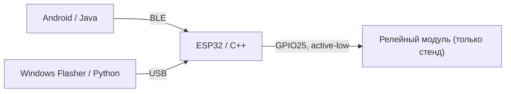

# 🤖 IERIKHON · Контекст для ИИ и разработчиков

> **Назначение:** этот документ помогает ChatGPT, Qwen, Claude и другим помощникам сразу понять проект, обнаружить важные файлы и не перепутать версии. Он не заменяет чтение кода.

## Короткое описание

IERIKHON — экспериментальная система дистанционного управления релейным выходом для прототипа мотоциклетного стартера. В состав входят Android-приложение с BLE, прошивка ESP32 и отдельный Windows-прошивальщик. **Текущая версия не должна применяться для запуска действующего мотоцикла без независимых аппаратных межблокировок и аутентификации.**

| Компонент | Версия | Исходный файл |
|---|---|---|
| Android-клиент | 1.5.7 | [Собранный Java](../source-archive/v1.5.7/generated/android/MainActivityV152.java) |
| Прошивка ESP32 | 1.5.4 | [INO](../firmware/IERIKHON_v1.5.4/IERIKHON_v1.5.4.ino) |
| Windows Flasher | 1.0.4 | [Обёртка Python](../pc-flasher/ierikhon_flasher_v104.py) + [ядро](../pc-flasher/ierikhon_flasher.py) |
| Историческая база Android | 1.5.2 | [MainActivityV152.java](../app/src/main/java/com/sdrx/ierikhon/MainActivityV152.java) |
| Патчи Android 1.5.7 | последовательная обработка | [v154](../tools/v154_patch.py), [soft UI](../tools/soft_ui_patch.py), [v157](../tools/v157_patch.py) |

## Архитектура и протокол

- Питание прототипа — отдельный вопрос электрической безопасности. Не считайте фотографию схемы проверенной монтажной инструкцией.
- BLE-служба, характеристики, форматы команд и ответы должны сохранять совместимость Android ↔ ESP32; **конкретные определения ищите в исходниках**, а не придумывайте.
- Существующая прошивка ESP32 1.5.4 не обеспечивает проверку авторизованного BLE-клиента; не утверждайте обратное.
- Отсутствуют независимые межблокировки включения стартера: нейтраль, сцепление и контроль работающего двигателя.

## Как ИИ должен работать с проектом

1. Начните с [README](../README.md), [карты исходников](SOURCE-MAP.md) и [предупреждений](SECURITY-NOTICE-v1.5.4.md).
2. Уточните целевой компонент и версию. **Не путайте** готовый Java v1.5.7 с базовым Java v1.5.2 или конфигурацией v1.5.8 в корне.
3. Перед изменениями проверьте взаимозависимые BLE-команды и ответы по обоим исходникам Android и ESP32.
4. Отделяйте то, что **реализовано**, от планов и предложений. Не выдавайте схему за проверенный безопасный проект.
5. Предлагайте изменения отдельными патчами/ветками, оставляя историю исходных версий для сравнения. Для сборок и условий см. [Android](ANDROID-BUILD.md) и [Flasher](FLASHER-BUILD.md).
6. Не добавляйте личные email, пароли, ключи подписи, токены, сведения из закрытой Git-истории в публичный репозиторий.
7. Если задача касается реального пуска двигателя, сначала опишите обязательные аппаратные блокировки, угрозы BLE и верификацию на изолированном стенде. Не предлагайте непосредственное включение стартера в обход блокировок.

## Готовое задание для ИИ

> Ты инженер по Android Java, BLE, ESP32 C++ и Python. Это публичный проект IERIKHON: Android 1.5.7, ESP32 1.5.4, Windows Flasher 1.0.4. Прочитай README.md, docs/AI-QUICK-CONTEXT.md, docs/SOURCE-MAP.md и docs/SECURITY-NOTICE-v1.5.4.md. Перед изменением проверь взаимосвязь приложения, BLE-протокола и прошивки. Разделяй реализованное и гипотезы. Сохраняй оригинальные файлы, покажи конкретный diff и план проверки на изолированном стенде. Не выдавай текущую систему за безопасный автозапуск реального транспорта.

## Дополнительно

- [Полная карта репозитория](SOURCE-MAP.md)
- [Инструкция по передаче проекта нейросети](AI-HANDOFF.md)
- [Сведения о публичной копии](PUBLICATION-NOTES.md)
- [Схема и её ограничения](WIRING-SCHEME.md)
- [Telegram SDRX_GARAGE](https://t.me/SDRX_GARAGE)
