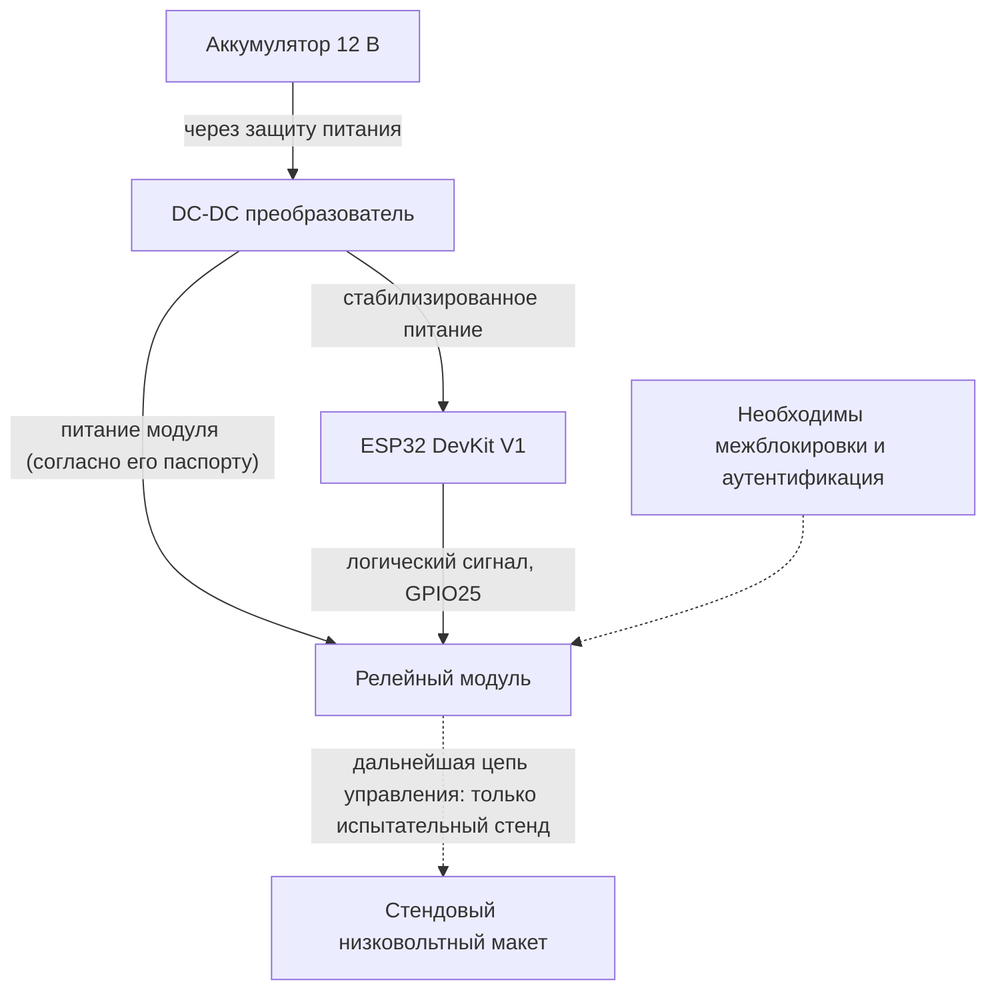

# 🔌 IERIKHON · Иллюстрация электрической архитектуры

**Статус: концептуальная схема, не проверенная монтажная инструкция.**

Владелец представил изображение прототипа: аккумулятор 12 В, DC–DC 12→5 В, ESP32 DevKit V1, релейный модуль 5 В и цепь кнопки стартера. Исходная фотография **ещё не добавлена в этот репозиторий**. Если она будет загружена в `docs/images/wiring-remote-start.jpg`, её можно показать прямо здесь:

<!-- Когда схема загружена в GitHub, можно раскомментировать следующую строку:

-->

## Принципиальная блочная схема

## Что нужно проверить перед любым испытанием

- **Питание реле.** Катушка 5 В и питание входной логики — не одно и то же. На представленной владельцем картинке красный провод к VCC реле проведён от вывода **3V3** ESP32, что **не соответствует** заявленному питанию 5-вольтового реле. Такую связку нельзя считать корректной или гарантированно работоспособной.
- **Совместимость логических уровней.** GPIO ESP32 использует логику 3,3 В; не каждый 5-вольтовый модуль реле корректно и безопасно запускается от такого сигнала.
- **Тип входа и активный уровень.** В прошивке ESP32 1.5.4 используется управление GPIO25 active-low. Уточняйте характеристики конкретной платы реле, включая ток управляющего входа.
- **Силовые контакты.** Тип (NO/NC), маркировка и пригодность к электрической системе мотоцикла не подтверждены одной иллюстрацией.
- **Защита питания.** В автомобильной/мотоциклетной сети возможны скачки напряжения, переполюсовка, помехи и провалы. Обычный открытый лабораторный DC–DC модуль не равен проверенному автомобильному питанию.
- **Безопасность запуска.** Нужны независимые аппаратные проверки нейтрали/сцепления, запрет запуска при работающем двигателе, безопасное состояние при сбоях, аутентификация BLE-команд.

> [!CAUTION]
> Нельзя использовать эту картинку как единственное руководство по подключению к реальному стартеру. Пока перечисленные недостатки не устранены и не проверены на изолированном стенде, практическое подключение к действующему мотоциклу небезопасно.

Другие документы: [уведомление о безопасности](SECURITY-NOTICE-v1.5.4.md), [контекст для ИИ](AI-QUICK-CONTEXT.md), [README](../README.md).
